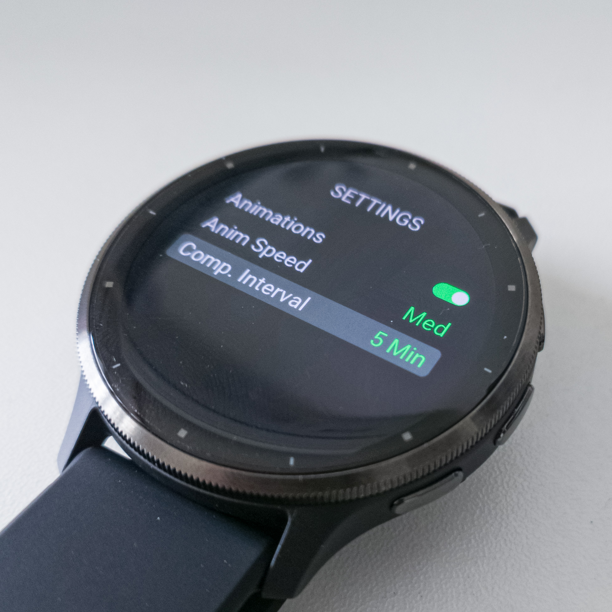
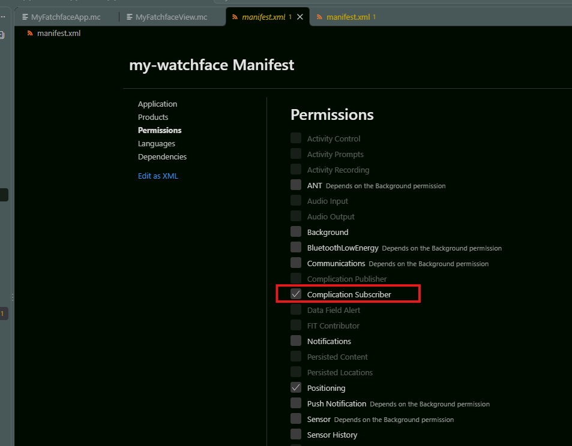
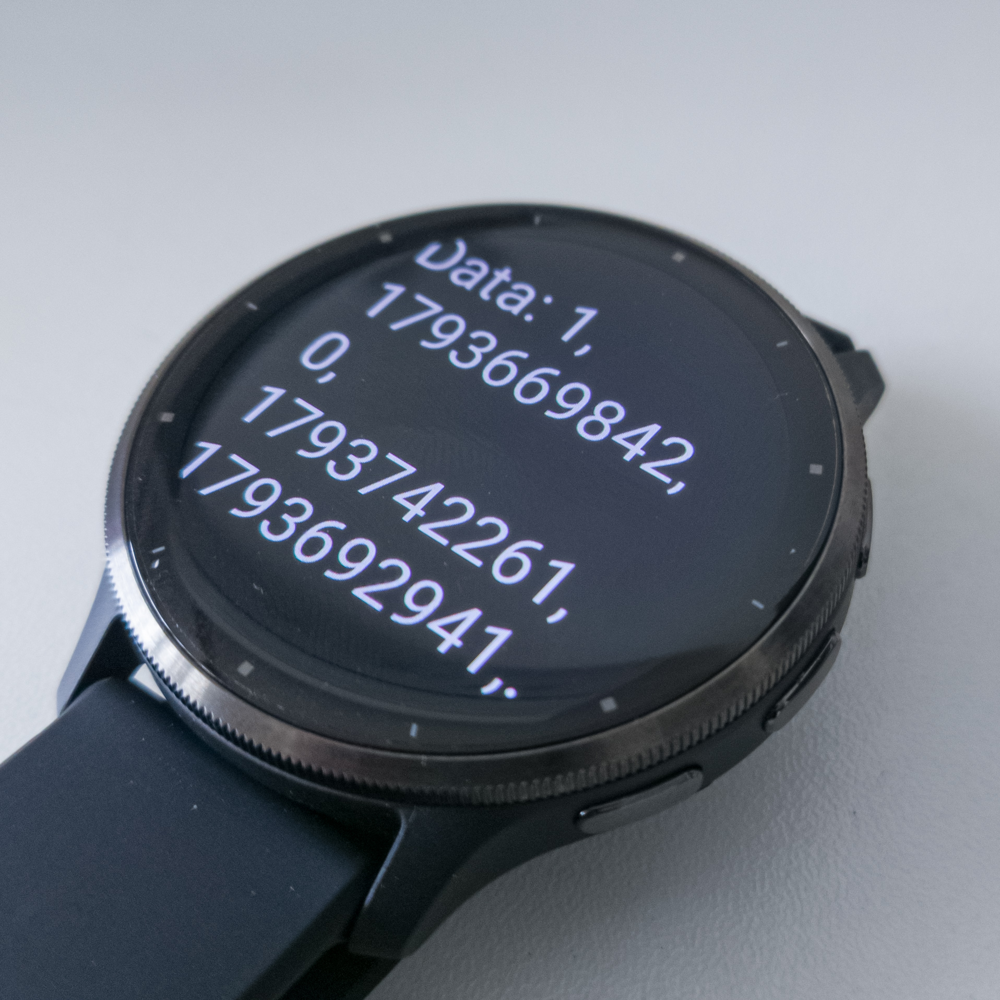

# Complication Provider API 仕様書 (V1)

本ドキュメントは、当アプリのコンプリケーション機能（バックグラウンドデータ提供機能）を利用して、Garminウォッチフェイス等（コンシューマー）を開発するためのインターフェース仕様書です。

---

## 1. データ更新の仕組みと初期設定

YAMAKAGEのコンプリケーションデータは、アプリがバックグラウンドで定期的にバックエンドAPIと通信を行うことで最新状態に保たれます。

- **更新間隔の設定:**
  バックグラウンドでのデータ更新間隔は、「YAMAKAGE - WatchApp」内の設定画面（Settings）からユーザーが任意に変更できます。
  

- **初期設定（デフォルト状態）:**
  YAMAKAGE - WatchApp のインストール直後は、意図しないバッテリー消費や通信を防ぐため、バックグラウンド更新機能は **「オフ（Off）」** に設定されています。
  サードパーティのウォッチフェイス等でこのコンプリケーションを利用・案内する際は、ユーザー自身にYAMAKAGEアプリを開き、設定画面から更新間隔を有効（例: 10 Min など）にするよう促す必要があります。

---

## 2. 開発に必要なマニフェスト設定 (manifest.xml)

ウォッチフェイス側（コンシューマー側）でYAMAKAGEのコンプリケーションを購読するためには、プロジェクトの `manifest.xml` に以下のパーミッションを追加する必要があります。



---

## 3. 提供するコンプリケーションと識別子について

YAMAKAGEでは、用途に合わせて以下の3種類のコンプリケーションをパブリッシュしています。ウォッチフェイス側からデータを特定し購読する場合は、`Complications.getComplications()` のイテレータを回し、各データの `shortLabel` をキーとして検索してください。

| データ内容 | ターゲット | `shortLabel` (検索キー) | 提供される `:value` の型・形式 |
| --- | --- | --- | --- |
| **全データセット (CSV)** | 開発者向け | `"YK CSV"` | `String` (カンマ区切りのデータ群。詳細は4章以降) |
| **日の出時間** | 一般ユーザー/開発者 | `"YK Sunrise"` | `String` (例: `"06:30"` / `"6:30a"`) ※端末の12/24H設定に依存 |
| **日の入り時間** | 一般ユーザー/開発者 | `"YK Sunset"` | `String` (例: `"18:45"` / `"6:45p"`) ※端末の12/24H設定に依存 |

---

## 4. 開発者向けデータ (CSV) のフォーマット概要

上記で `YK CSV` として提供されるコンプリケーションの `:value` プロパティには、各要素がカンマ（`,`）で連結された **1つのCSV形式の文字列（`String`）** が格納されて配信されます。

コンシューマー側では、受け取った文字列をカンマで分割（パース）し、下記の「データスキーマ」のインデックス順序に従って各値を取得・型変換して利用してください。

### ペイロードの例

* **正常取得時:**
`"1,1730000000,0,1729976400,1730016000,1729990000,1730030000,0.5,0.98,125"`
* **エラー発生時（例: 通信エラー）:**
`"1,1730000000,2,0,0,0,0,0,0,0"`

---

## 5. 開発者向けデータ (CSV) スキーマ (Schema V1)

分割後の配列インデックスと、各データの型・内容は以下の通りです（要素数：`10`）。

| インデックス | フィールド名 | 型 (変換後) | 説明 | エラー時の値 |
| --- | --- | --- | --- | --- |
| `0` | `VERSION` | `Number` | スキーマバージョン（現在は `1` 固定） | `1` |
| `1` | `TIMESTAMP` | `Number` | データ生成日時（Unixタイムスタンプ / 秒） | 実行時のUnixタイムスタンプ |
| `2` | `STATUS` | `Number` | 通信・取得ステータス（詳細は後述の「ステータスコード」を参照） | 各エラーステータス値 (`1`〜`4`) |
| `3` | `SUNRISE_TIME` | `Number` | 日の出時刻（Unixタイムスタンプ / 秒） | `0` |
| `4` | `SUNSET_TIME` | `Number` | 日の入り時刻（Unixタイムスタンプ / 秒） | `0` |
| `5` | `MOONRISE_TIME` | `Number` | 月の出時刻（Unixタイムスタンプ / 秒） | `0` |
| `6` | `MOONSET_TIME` | `Number` | 月の入り時刻（Unixタイムスタンプ / 秒） | `0` |
| `7` | `MOON_PHASE` | `Float` | 月相（`0.0` 〜 `1.0`） | `0` |
| `8` | `MOON_FRACTION` | `Float` | 月の輝面比（`0.0` 〜 `1.0`） | `0` |
| `9` | `ALTITUDE` | `Number` (or `Float`) | 標高（メートル） | `0` |

---

## 6. ステータスコードとエラー時の挙動 (`STATUS`)

インデックス `2` の `STATUS` には、データ取得の結果を示す数値が入ります。
`0`（`SUCCESS`）以外の場合は、インデックス `3`〜`9` のすべてのデータフィールドに `0` がセットされます。

| 値 | ステータス名 | 発生条件 | ウォッチフェイス側での推奨ハンドリング |
| --- | --- | --- | --- |
| `0` | `SUCCESS` | データの取得・更新に成功 | 取得した値を描画、またはキャッシュを更新して表示 |
| `1` | `NO_GPS` | デバイスでGPS位置情報が取得できない（圏外・未測位） | 「GPS未取得」アイコンの表示、または前回正常取得時のキャッシュデータを表示 |
| `2` | `NETWORK_ERROR` | スマートフォンとのBluetooth切断、またはスマホ側がオフライン | 「通信オフライン」アイコンの表示、またはキャッシュデータを表示 |
| `3` | `SERVER_ERROR` | APIサーバー側の障害、またはリクエスト不備（HTTP 400〜500番台） | 「`--:--`」等のフォールバック表示、またはキャッシュデータを表示 |
| `4` | `UNKNOWN_ERROR` | 予期せぬエラー | 「`--:--`」等のフォールバック表示。`YAMAKAGE`のリポジトリにissueを投げてください。 |

> **💡 実装のヒント（キャッシュの活用）:**
> バックグラウンド通信はユーザーの移動中などに一時的な通信エラー（`NETWORK_ERROR`）やGPSロスト（`NO_GPS`）を起こすことがあります。ウォッチフェイス側では、`STATUS == 0` のときにデータを `Storage` 等にキャッシュしておき、エラー発生時は「前回のキャッシュデータを表示しつつ、小さくエラーインジケーターを出す」といった設計にすると、ユーザー体験（UX）が向上します。

---

## 7. 実装例
以下は利用側ウォッチフェイスで簡易的にYAMAKAGEのコンプリケーションを利用するWatchFaceコードです。

ファイル構成はエントリポイントとビューの2つだけです。

### `MyFatchfaceApp.mc`
```java
import Toybox.Application;
import Toybox.Lang;
import Toybox.System;
import Toybox.WatchUi;
import Toybox.Complications;

// サンプルコードなのでとりあえずグローバルに保持(後でViewで参照)
var gDisplayData as String = "";
var gSuccessSubscribe = false;

module ComplicationUtils {
    function findByShortLabel(
        shortLabel as String
    ) as Complications.Complication? {
        // shortLabelからComplicationオブジェクトを取得する
        var iter = Complications.getComplications();
        var comp = iter.next();

        while (comp != null) {
            System.println(comp.shortLabel);
            if (comp.shortLabel != null && comp.shortLabel.equals(shortLabel)) {
                return comp;
            }
            comp = iter.next();
        }
        return null;
    }
}

class MyFatchfaceApp extends Application.AppBase {
    var _complicationId as Complications.Id?;

    function initialize() {
        AppBase.initialize();
    }

    function onStart(state as Dictionary?) as Void {
        // Complicationオブジェクトを取得
        var comp = ComplicationUtils.findByShortLabel("YK CSV");
        if (comp == null || comp.complicationId == null) {
            return;
        }

        // idをクラス内で保持
        _complicationId = comp.complicationId;

        // 値が更新されたときに呼ばれるコールバックを登録
        Complications.registerComplicationChangeCallback(
            method(:onComplicationChanged)
        );

        // 購読スタート
        try {
            gSuccessSubscribe =
                Complications.subscribeToUpdates(_complicationId);
        } catch (e) {
            System.println("エラー: " + e.getErrorMessage());
            gSuccessSubscribe = false;
        }

        // 初期データ反映
        if (gSuccessSubscribe) {
            System.println("OK");
            gSuccessSubscribe = true;
            _refreshComplication(_complicationId);
        }
    }

    function onComplicationChanged(complicationId as Complications.Id) as Void {
        // コンプリケーションデータが変更された場合のコールバック
        if (_complicationId != null && complicationId.equals(_complicationId)) {
            _refreshComplication(complicationId);
        }
    }

    function _refreshComplication(id as Complications.Id) as Void {
        try {
            var comp = Complications.getComplication(id);
            var value = comp.value;

            gDisplayData = value instanceof String ? value : "";
        } catch (e instanceof Complications.ComplicationNotFoundException) {
            System.println("コンプリケーション取得エラー: " + e);
            _complicationId = null;
            gDisplayData = "コンプリケーション取得エラー";
        }
        WatchUi.requestUpdate();
    }

    function getInitialView() as [Views] or [Views, InputDelegates] {
        return [new MyFatchfaceView()];
    }
}

function getApp() as MyFatchfaceApp {
    return Application.getApp() as MyFatchfaceApp;
}

```

### `MyFatchfaceView.mc`

```java
import Toybox.Graphics;
import Toybox.WatchUi;

class MyFatchfaceView extends WatchUi.WatchFace {
    private var _textArea;
    private var _displayData;

    function initialize() {
        WatchFace.initialize();

        _displayData = gSuccessSubscribe
            ? gDisplayData 
            : "fail subsc";
    }

    function onLayout(dc as Graphics.Dc) as Void {
        // 今回は見やすいようにテキストエリアを用意
        _textArea = new WatchUi.TextArea({
            :text => "",
            :color => Graphics.COLOR_WHITE,
            :font => [Graphics.FONT_LARGE],
            :locX => WatchUi.LAYOUT_HALIGN_CENTER,
            :locY => WatchUi.LAYOUT_VALIGN_CENTER,
            :width => dc.getWidth() * 0.8,
            :height => dc.getHeight() * 0.8,
            :justification => Graphics.TEXT_JUSTIFY_LEFT | Graphics.TEXT_JUSTIFY_VCENTER
        });
    }

    function onUpdate(dc as Graphics.Dc) as Void {
        dc.setColor(Graphics.COLOR_BLACK, Graphics.COLOR_BLACK);
        dc.clear();

        _textArea.setText("Data: " + _displayData);
        _textArea.draw(dc);
    }
}
```

サンプルコードでは`comp.value`をそのまま画面に表示しています。



YAMAKAGEの`日の出時間`と`日の入り時間`については、すでにラベルになっているのでこのまま表示できますが、`全データセット (CSV)`についてはCSVパース処理をいれてオブジェクトなどにマッピングする感じの実装になると思います。