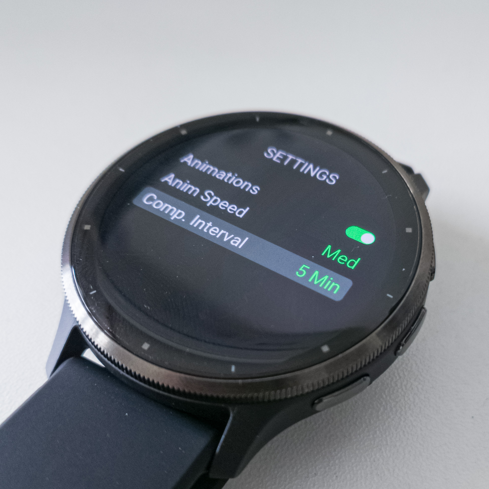
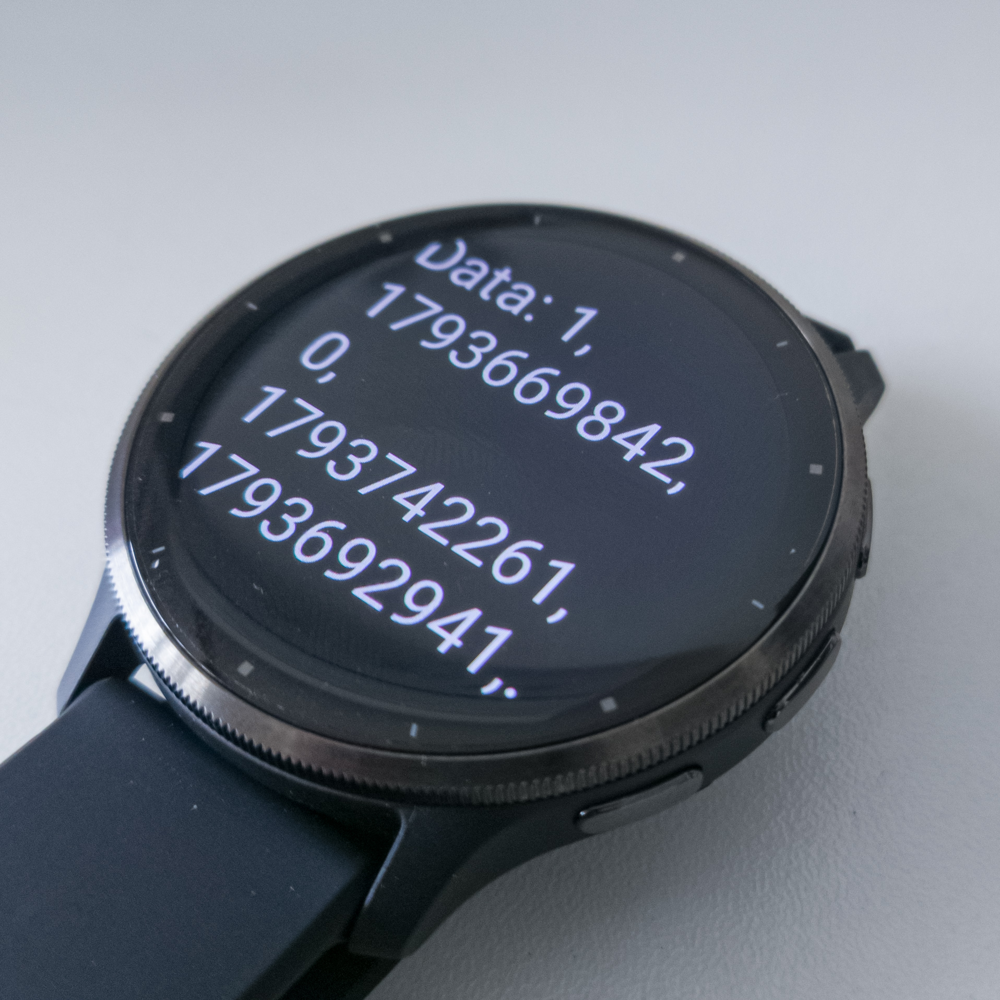

# Complication Provider API Specification (V1)

This document describes the interface specification for developers who want to build Garmin watch faces and other consumer applications that use the complication functionality (background data provider) offered by this app.

---

## 1. Data Update Mechanism and Initial Setup

YAMAKAGE complication data is kept up to date through periodic background communication between the app and its backend API.

- **Configuring the update interval:**
  
  The background data update interval can be changed by the user in the Settings screen of **YAMAKAGE - WatchApp**.
  

- **Initial settings (default state):**
  
  Immediately after installation, background updates are **Off** by default to prevent unintended battery consumption and network activity.
  
  When developing or recommending a third-party watch face or other application that uses this complication, you must instruct users to open the YAMAKAGE app and enable background updates from the Settings screen by selecting an interval (e.g., 10 Min).

---

## 2. Required Manifest Configuration (`manifest.xml`)

To subscribe to YAMAKAGE complications from the consumer side (e.g., a watch face), add the following permission to your project's `manifest.xml`:

```xml
<iq:uses-permission id="ComplicationSubscriber"/>
```

---

## 3. Available Complications and Identifiers

YAMAKAGE publishes the following three types of complications for different use cases. To locate and subscribe to a specific complication from a watch face, iterate over the collection returned by `Complications.getComplications()` and use each complication's `shortLabel` as the lookup key.

| Data | Target Audience | `shortLabel` (Lookup Key) | Type and Format of `:value` |
| --- | --- | --- | --- |
| **Full Dataset (CSV)** | Developers | `"YK Dev CSV"` | `String` (comma-separated data; see Sections 4 onward for details) |
| **Sunrise Time** | General Users / Developers | `"YK Sunrise"` | `String` (e.g., `"06:30"` / `"6:30a"`) — depends on the device's 12/24-hour time format setting |
| **Sunset Time** | General Users / Developers | `"YK Sunset"` | `String` (e.g., `"18:45"` / `"6:45p"`) — depends on the device's 12/24-hour time format setting |

> ⚠️ **Development Note:**
>
> According to Garmin's specifications, complication IDs (`Complications.Id`) are assigned dynamically depending on the device and installation state. Therefore, do not rely on hardcoded IDs. Instead, iterate over the complications in your code and dynamically locate the object whose `shortLabel` matches `"YK Dev CSV"` or another relevant label.

---

## 4. Overview of the Developer Data (CSV) Format

The `:value` property of the `"YK Dev CSV"` complication contains a **single CSV-formatted string (`String`)** in which individual values are concatenated and separated by commas (`,`).

On the consumer side, split the received string by commas, parse the resulting values, and retrieve and convert each value according to its index in the data schema below.

### Example Payloads

- **Successful response:**

  `"1,1730000000,0,1729976400,1730016000,1729990000,1730030000,0.5,0.98,125"`

- **Error response (e.g., network error):**

  `"1,1730000000,2,0,0,0,0,0,0,0"`

---

## 5. Developer Data (CSV) Schema (Schema V1)

The following table describes the array indices, data types after conversion, and meanings of the individual fields. The total number of elements is `10`.

| Index | Field Name | Type (After Conversion) | Description | Value on Error |
| --- | --- | --- | --- | --- |
| `0` | `VERSION` | `Number` | Schema version (currently fixed at `1`) | `1` |
| `1` | `TIMESTAMP` | `Number` | Data generation time (Unix timestamp in seconds) | Current Unix timestamp at runtime |
| `2` | `STATUS` | `Number` | Data retrieval and communication status (see the Status Codes section below) | Corresponding error status code (`1`–`4`) |
| `3` | `SUNRISE_TIME` | `Number` | Sunrise time (Unix timestamp in seconds) | `0` |
| `4` | `SUNSET_TIME` | `Number` | Sunset time (Unix timestamp in seconds) | `0` |
| `5` | `MOONRISE_TIME` | `Number` | Moonrise time (Unix timestamp in seconds) | `0` |
| `6` | `MOONSET_TIME` | `Number` | Moonset time (Unix timestamp in seconds) | `0` |
| `7` | `MOON_PHASE` | `Float` | Moon phase (`0.0`–`1.0`) | `0` |
| `8` | `MOON_FRACTION` | `Float` | Lunar illuminated fraction (`0.0`–`1.0`) | `0` |
| `9` | `ALTITUDE` | `Number` (or `Float`) | Elevation above sea level, in meters | `0` |

---

## 6. Status Codes and Error Handling (`STATUS`)

The `STATUS` field at index `2` indicates the result of data retrieval.

When `STATUS` is anything other than `0` (`SUCCESS`), all data fields at indices `3`–`9` are set to `0`.

| Value | Status Name | Condition | Recommended Handling on the Watch Face |
| --- | --- | --- | --- |
| `0` | `SUCCESS` | Data retrieval and update succeeded | Display the retrieved values or update the cache and display the cached data |
| `1` | `NO_GPS` | The device's GPS location is unavailable (e.g., no GPS signal or no position fix) | Display a "GPS unavailable" icon or show data cached from the last successful retrieval |
| `2` | `NETWORK_ERROR` | The Bluetooth connection to the smartphone is disconnected, or the smartphone is offline | Display a "Network offline" icon or show cached data |
| `3` | `SERVER_ERROR` | The API server is experiencing an issue, or the request is invalid (HTTP 400–500 status codes) | Display a fallback value such as `"--:--"` or show cached data |
| `4` | `UNKNOWN_ERROR` | An unexpected error occurred | Display a fallback value such as `"--:--"`. Please open an issue in the YAMAKAGE repository. |

> **💡 Implementation Tip: Using a Cache**
>
> Background communication may occasionally fail due to temporary network errors (`NETWORK_ERROR`) or GPS signal loss (`NO_GPS`), for example, while the user is moving.
>
> To improve the user experience (UX), consider caching the data whenever `STATUS == 0` using `Storage` or a similar mechanism. When an error occurs, continue displaying the previously cached data while showing a small error indicator.

---

## 7. Implementation Example

Below is a sample WatchFace code that simply utilizes the YAMAKAGE complication on the consumer watch face.

The file structure consists of just two files: an entry point and a view.

### `MyFatchfaceApp.mc`

```java
import Toybox.Application;
import Toybox.Lang;
import Toybox.System;
import Toybox.WatchUi;
import Toybox.Complications;

// Stored globally for this sample code (referenced later in the View)
var gDisplayData as String = "";
var gSuccessSubscribe = false;

module ComplicationUtils {
    function findByShortLabel(
        shortLabel as String
    ) as Complications.Complication? {
        // Retrieve Complication object from shortLabel
        var iter = Complications.getComplications();
        var comp = iter.next();

        while (comp != null) {
            System.println(comp.shortLabel);
            if (comp.shortLabel != null && comp.shortLabel.equals(shortLabel)) {
                return comp;
            }
            comp = iter.next();
        }
        return null;
    }
}

class MyFatchfaceApp extends Application.AppBase {
    var _complicationId as Complications.Id?;

    function initialize() {
        AppBase.initialize();
    }

    function onStart(state as Dictionary?) as Void {
        // Retrieve Complication object
        var comp = ComplicationUtils.findByShortLabel("YK CSV");
        if (comp == null || comp.complicationId == null) {
            return;
        }

        // Store the id within the class
        _complicationId = comp.complicationId;

        // Register a callback invoked when the value is updated
        Complications.registerComplicationChangeCallback(
            method(:onComplicationChanged)
        );

        // Start subscription
        try {
            gSuccessSubscribe =
                Complications.subscribeToUpdates(_complicationId);
        } catch (e) {
            System.println("Error: " + e.getErrorMessage());
            gSuccessSubscribe = false;
        }

        // Apply initial data
        if (gSuccessSubscribe) {
            System.println("OK");
            gSuccessSubscribe = true;
            _refreshComplication(_complicationId);
        }
    }

    function onComplicationChanged(complicationId as Complications.Id) as Void {
        // Callback when complication data is changed
        if (_complicationId != null && complicationId.equals(_complicationId)) {
            _refreshComplication(complicationId);
        }
    }

    function _refreshComplication(id as Complications.Id) as Void {
        try {
            var comp = Complications.getComplication(id);
            var value = comp.value;

            gDisplayData = value instanceof String ? value : "";
        } catch (e instanceof Complications.ComplicationNotFoundException) {
            System.println("Complication retrieval error: " + e);
            _complicationId = null;
            gDisplayData = "Complication retrieval error";
        }
        WatchUi.requestUpdate();
    }

    function getInitialView() as [Views] or [Views, InputDelegates] {
        return [new MyFatchfaceView()];
    }
}

function getApp() as MyFatchfaceApp {
    return Application.getApp() as MyFatchfaceApp;
}


```

### `MyFatchfaceView.mc`

```java
import Toybox.Graphics;
import Toybox.WatchUi;

class MyFatchfaceView extends WatchUi.WatchFace {
    private var _textArea;
    private var _displayData;

    function initialize() {
        WatchFace.initialize();

        _displayData = gSuccessSubscribe
            ? gDisplayData 
            : "fail subsc";
    }

    function onLayout(dc as Graphics.Dc) as Void {
        // Prepare a text area for better visibility in this sample
        _textArea = new WatchUi.TextArea({
            :text => "",
            :color => Graphics.COLOR_WHITE,
            :font => [Graphics.FONT_LARGE],
            :locX => WatchUi.LAYOUT_HALIGN_CENTER,
            :locY => WatchUi.LAYOUT_VALIGN_CENTER,
            :width => dc.getWidth() * 0.8,
            :height => dc.getHeight() * 0.8,
            :justification => Graphics.TEXT_JUSTIFY_LEFT | Graphics.TEXT_JUSTIFY_VCENTER
        });
    }

    function onUpdate(dc as Graphics.Dc) as Void {
        dc.setColor(Graphics.COLOR_BLACK, Graphics.COLOR_BLACK);
        dc.clear();

        _textArea.setText("Data: " + _displayData);
        _textArea.draw(dc);
    }
}

```

In the sample code, `comp.value` is displayed directly on the screen.



For YAMAKAGE's `Sunrise Time` and `Sunset Time`, they are already formatted as labels, so they can be displayed as is. However, for the `Full Data Set (CSV)`, the implementation would typically involve parsing the CSV and mapping it to an object.